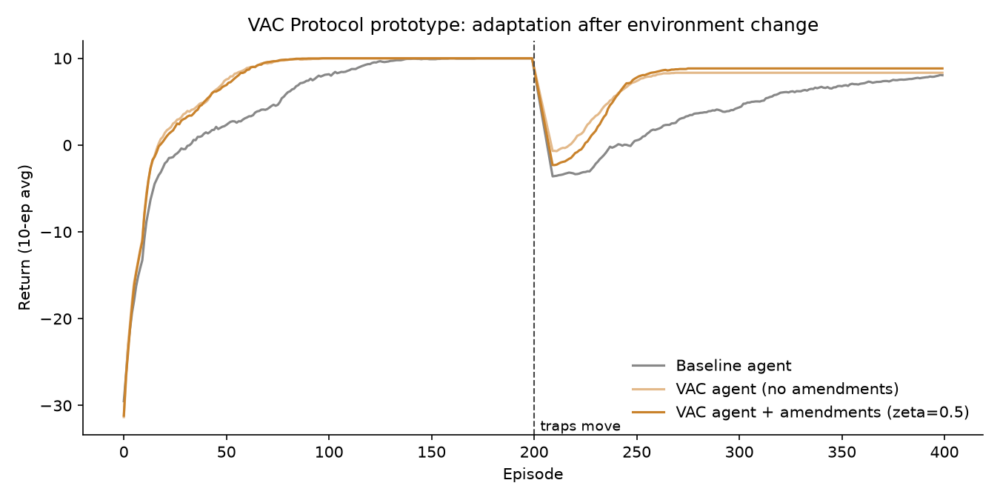

# VAC Protocol

A working prototype of the **VAC System (Volitional-Affective Collapse Protocol) V1.0** by kysemantic.eth.

The nine modules in the white paper are being turned into runnable code. The agent loads its "volitional genome" from the VAC Protocol NFTs on-chain.

> "Pain", "will" and "survival drive" are names for system variables. They do not mean the machine has feelings or consciousness.

## Quick start: the NFTs are the entry point

```bash
python3 vac_agent.py            # 1. read the NFTs on-chain → 2. enable modules → 3. run the experiment
python3 vac_agent.py --offline  # use an existing vac_genome.json
```

The agent first reads the VAC Protocol NFTs on Ethereum, and each module (001–009) is enabled only if its NFT is found. It then compares a standard agent with the VAC agent in a grid world, where the traps move halfway through. Results go to `results.md` and `results.png`.

Every push runs this automatically on GitHub Actions and commits the latest results back to the repo.



See [results.md](results.md) for the full results.

## Step 1: Read the NFT genome

```bash
python3 read_vac_nft.py                  # auto-detect the chain, read tokens 1–9
python3 read_vac_nft.py --chain base     # specify the chain
python3 read_vac_nft.py --ids 0-10       # specify a token range
```

- Read-only. It needs no private key and costs no gas.
- It uses only the Python standard library, so there is nothing to install.
- The output is `vac_genome.json`.

Contract: `0x4e22b334e53c1dc7e266b5996d32c05a6ac8f4fb`

## Constitutional amendments (on-chain rules)

| Token | Amendment | What the program does |
|---|---|---|
| #12 | A01 Emotional Circuit Breaker | Reads `SE Threshold` and `Cooldown Steps`; when pain exceeds the limit, the signal is capped and the agent cools down |
| #13 | A02 Creator Veto | **Checked first.** The program runs only while token #13 and Axiom #003 (token #4) are held by the same wallet; otherwise it halts. If ownership can't be confirmed on-chain, it also halts |
| #14 | A03 Zeta Calibration | Reads `Zeta` and uses it as ζ_vac |

To halt the system, transfer token #13 to another wallet. To resume, transfer it back.

## Module map (white paper → code)

| # | Module | Planned implementation |
|---|---|---|
| 001 | Irreversibility | Each step spends an energy budget; policy entropy is logged |
| 002 | Reciprocity | Will W (goal drive) / Resistance R (traps) |
| 003 | Recursive Closure | The affect signal updates value estimates |
| 004 | Attentional Manifold | Candidate actions with their value and cost |
| 005 | Collapse Operator | Probabilistic action selection |
| 006 | Affective Sensor | Prediction error → affect scalar SE |
| 007 | Re-entry Modulator | Boltzmann temperature adjusted by SE |
| 008 | Universal Constant ζ_vac | Global affect sensitivity |
| 009 | Unified Manifesto | Main loop plus report |

## Roadmap

- [x] Read NFT metadata on-chain
- [x] Grid-world environment
- [x] Implement modules 001–009 (enabled from the NFTs)
- [x] Controlled experiment: standard agent vs. VAC agent
- [x] Write numeric parameters into NFT metadata (amendments A01–A03)
- [x] Creator veto (A02)
- [ ] Tune the baseline agent so the comparison is stricter

## License

This code is licensed under the [PolyForm Noncommercial License 1.0.0](LICENSE.md).

- ✅ **Free for noncommercial use**: personal projects, study, research, education, and nonprofits.
- 💼 **Commercial use requires a license**: companies or commercial products that want to use this code must get a commercial license from the author. To ask, open an [Issue](https://github.com/kycat2026-ui/vac-protocol/issues) or contact kysemantic.eth.

This license covers this repository's code only. The VAC Protocol white paper, NFT artwork and metadata stay the property of kysemantic.eth.

